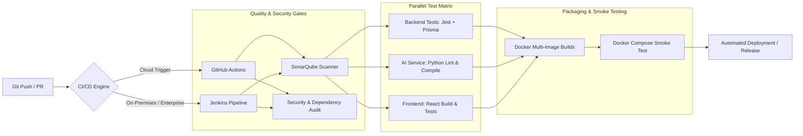

# CI/CD & DevOps Automation Architecture Documentation

## 1. Overview
The **My Academia** platform employs a dual-pipeline CI/CD automation strategy leveraging **GitHub Actions** and **Declarative Jenkins Pipelines**, supported by **SonarQube Quality Gates**, **Docker Compose Orchestration**, and automated deployment probers.



---

## 2. Key Pipeline Components

### 2.1 Jenkins Declarative Pipeline (`Jenkinsfile`)
- **Stage 1: Checkout & Environment Init**: Cleans workspace and pulls target branch.
- **Stage 2: Code Quality & SonarQube**: Executes static analysis matching `sonar-project.properties`.
- **Stage 3: Security Vulnerability Audit**: Runs `npm audit` and Python safety checks.
- **Stage 4: Parallel Test Stage**:
  - **Backend**: Generates Prisma client and executes Jest unit & security tests.
  - **AI Service**: Compiles Python bytecode and validates module imports.
  - **Frontend**: Compiles React SPA production assets.
- **Stage 5: Multi-Container Docker Build**: Builds images for Backend, AI Service, API Gateway, and Frontend.
- **Stage 6: Docker Compose Smoke Test**: Spins up isolated integration environment and verifies gateway endpoints.

### 2.2 GitHub Actions Workflow (`.github/workflows/ci.yml`)
- Runs on every push and pull request against `main`, `master`, and `dev`.
- Validates code across all 4 services concurrently.
- Verifies Docker Compose build and container orchestration health.

### 2.3 SonarQube Scanner (`sonar-project.properties`)
- Analyzes code across JavaScript, Python, and JSX.
- Tracks test coverage metrics, code smells, duplication, and potential vulnerabilities.

### 2.4 Automated Deployment & Healthcheck Scripts (`scripts/`)
- [`scripts/deploy.sh`](file:///d:/My%20Projects/my_academia-main/scripts/deploy.sh): Production deployment automation for Linux/CI/CD.
- [`scripts/deploy.ps1`](file:///d:/My%20Projects/my_academia-main/scripts/deploy.ps1): Automated deployment script for Windows environments.
- [`scripts/healthcheck.js`](file:///d:/My%20Projects/my_academia-main/scripts/healthcheck.js): Automated cross-service health prober.

---

## 3. How to Run Locally

### Run Multi-Service Health Prober
```bash
node scripts/healthcheck.js
```

### Full Automated Docker Deployment
- **On Linux/macOS:**
  ```bash
  chmod +x scripts/deploy.sh
  ./scripts/deploy.sh
  ```
- **On Windows:**
  ```powershell
  .\scripts\deploy.ps1
  ```